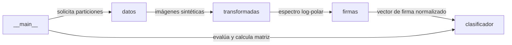

[Leer en español](README.md)

# Reconocimiento de patrones con Fourier-Mellin

Pattern recognition and classification invariant to translation, rotation, and scale on synthetic images using Fourier-Mellin descriptors and nearest neighbor.

[](https://github.com/ale0009/reconocimiento-patrones-fourier/actions/workflows/ci.yml)


## Why this exists

Classify letters rendered in synthetic images subject to concurrent variations in position, orientation, scale, and noise.

## Architecture



### Components

| Component | Responsibility |
| --- | --- |
| `datos` | Generación sintética de imágenes de letras, particionado reproducible (entrenamiento, validación, prueba) y renderizado tipográfico. |
| `transformadas` | Preprocesamiento con ventana Hann, sustracción de media, cálculo de FFT2 centrada y remuestreo log-polar bilineal. |
| `firmas` | Extracción del vector de firma concatenando bajas frecuencias centrales y proyecciones marginales con normalización L2. |
| `clasificador` | Estandarización dimensional basada en referencias de entrenamiento y asignación de clase por vecino más cercano euclidiano. |
| `__main__` | Punto de entrada CLI para coordinar la evaluación, reportar métricas de validación y prueba, y exportar la matriz de confusión. |

## Stack

- Python
- NumPy
- SciPy
- Pillow
- Matplotlib
- scikit-image
- pytest
- uv

## Getting Started

### Installation

```bash
uv sync --dev
```

### Testing

```bash
uv run pytest -q
```

### Execution

```bash
uv run python -m fourier_patrones evaluar
```

## Results

| Metric | Value | Note |
| --- | --- | --- |
| Exactitud en prueba (versión mejorada) | 93,75 % (75/80) | Medición final en partición de prueba con ventana Hann, bajas frecuencias, marginales y 30 referencias por clase. |
| Exactitud en validación (versión mejorada) | 95,00 % (76/80) | Medición en conjunto de validación con 30 referencias transformadas por clase. |
| Exactitud en prueba (versión base anterior) | 73,75 % (59/80) | Línea base previa del proyecto basada exclusivamente en descriptor de marginales. |

## Limitations and Roadmap

### Limitations

- El conjunto de datos es pequeño y sintético, por lo que no estima el desempeño frente a imágenes del mundo real.
- El renderizado de letras depende de las fuentes instaladas en el sistema operativo, lo que puede causar pequeñas variaciones tipográficas entre entornos.
- La evaluación de prueba representa el comportamiento bajo una única semilla fija (27182).

### Roadmap

- Evaluar el clasificador frente a conjuntos de caracteres reales y manuscritos.
- Comparar clasificadores alternativos más allá del vecino más cercano euclidiano.
- Empaquetar fuentes tipográficas fijas para eliminar dependencias de fuentes del sistema operativo.

## Origin

Individual, open-source reimplementation based on an academic team project at Universidad ECCI, carried out with my teammate **David Alexander Rincón Corredor (Kuronoma)** and team.

## License

This project is licensed under the terms of the MIT license. See the LICENSE file for details.

Copyright (c) 2026 Mario Alejandro Puerta Alarcón.
