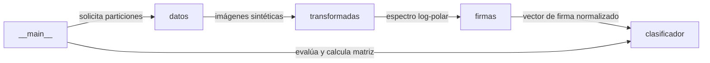

# Arquitectura del Sistema: Reconocimiento de patrones con Fourier-Mellin

## Visión general

Clasificación de patrones invariante a traslación, rotación y escala en imágenes sintéticas mediante la transformada de Fourier-Mellin y vecino más cercano.

Clasificar letras dibujadas en imágenes sintéticas afectadas por variaciones simultáneas de posición, orientación, escala y ruido.

## Diagrama de arquitectura



## Componentes

| Componente | Responsabilidad |
| --- | --- |
| `datos` | Generación sintética de imágenes de letras, particionado reproducible (entrenamiento, validación, prueba) y renderizado tipográfico. |
| `transformadas` | Preprocesamiento con ventana Hann, sustracción de media, cálculo de FFT2 centrada y remuestreo log-polar bilineal. |
| `firmas` | Extracción del vector de firma concatenando bajas frecuencias centrales y proyecciones marginales con normalización L2. |
| `clasificador` | Estandarización dimensional basada en referencias de entrenamiento y asignación de clase por vecino más cercano euclidiano. |
| `__main__` | Punto de entrada CLI para coordinar la evaluación, reportar métricas de validación y prueba, y exportar la matriz de confusión. |

## Flujo de datos

1. **__main__** comunica con **datos**: solicita particiones.
2. **datos** comunica con **transformadas**: imágenes sintéticas.
3. **transformadas** comunica con **firmas**: espectro log-polar.
4. **firmas** comunica con **clasificador**: vector de firma normalizado.
5. **__main__** comunica con **clasificador**: evalúa y calcula matriz.

## Registro de Decisiones de Arquitectura (ADR)

- [ADR-0001: Uso de coordenadas log-polares sobre el espectro Fourier](adr/0001.md)
- [ADR-0002: Ventana Hann, firma de frecuencias bajas y aumento a 30 referencias](adr/0002.md)
- [ADR-0003: Gestión de dependencias y ejecución reproducible con uv y hatchling](adr/0003.md)

## Calidad y pruebas

La verificación técnica del sistema se realiza de forma automatizada mediante la ejecución de:

```bash
uv run pytest -q
```
